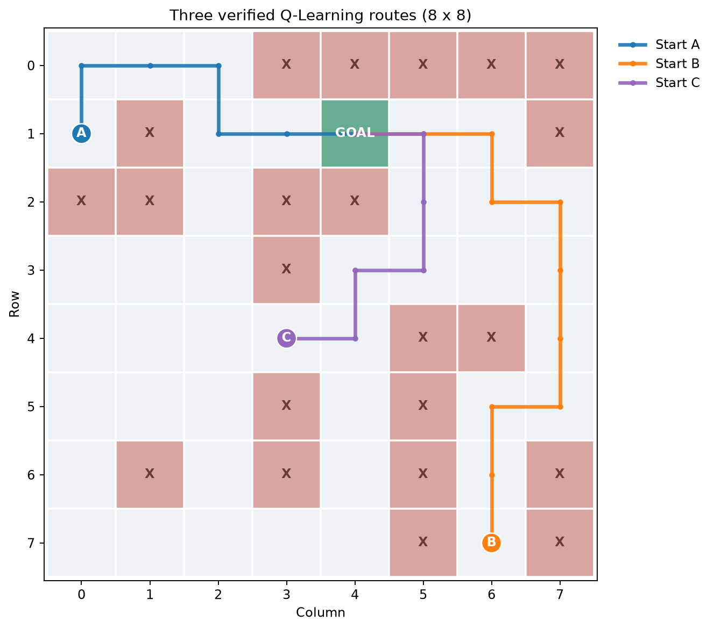
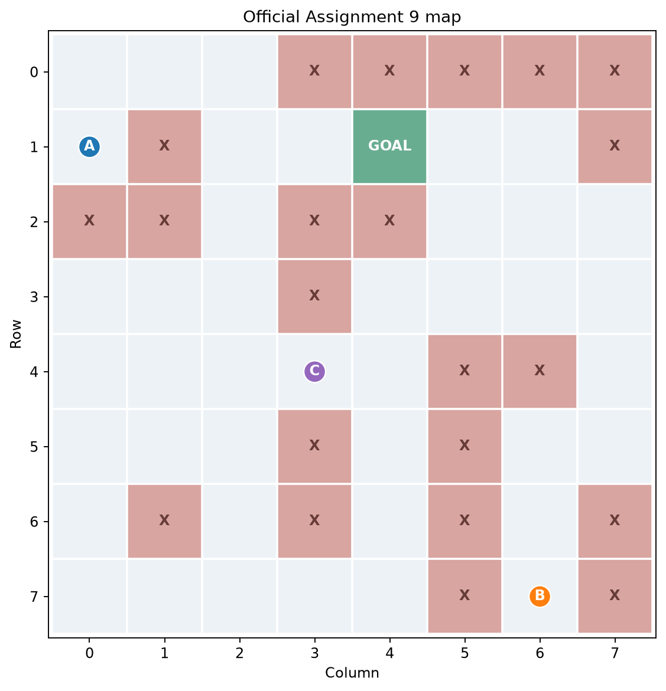
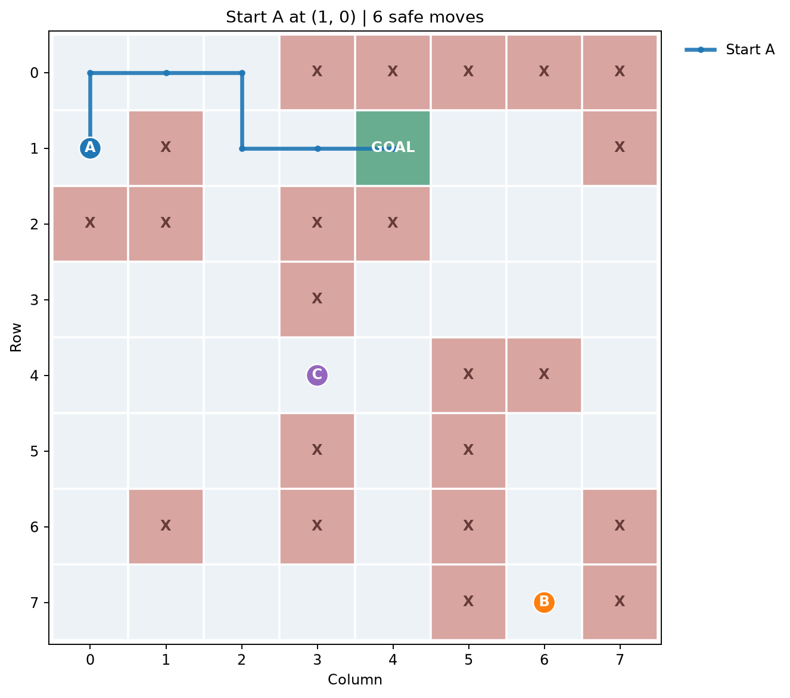
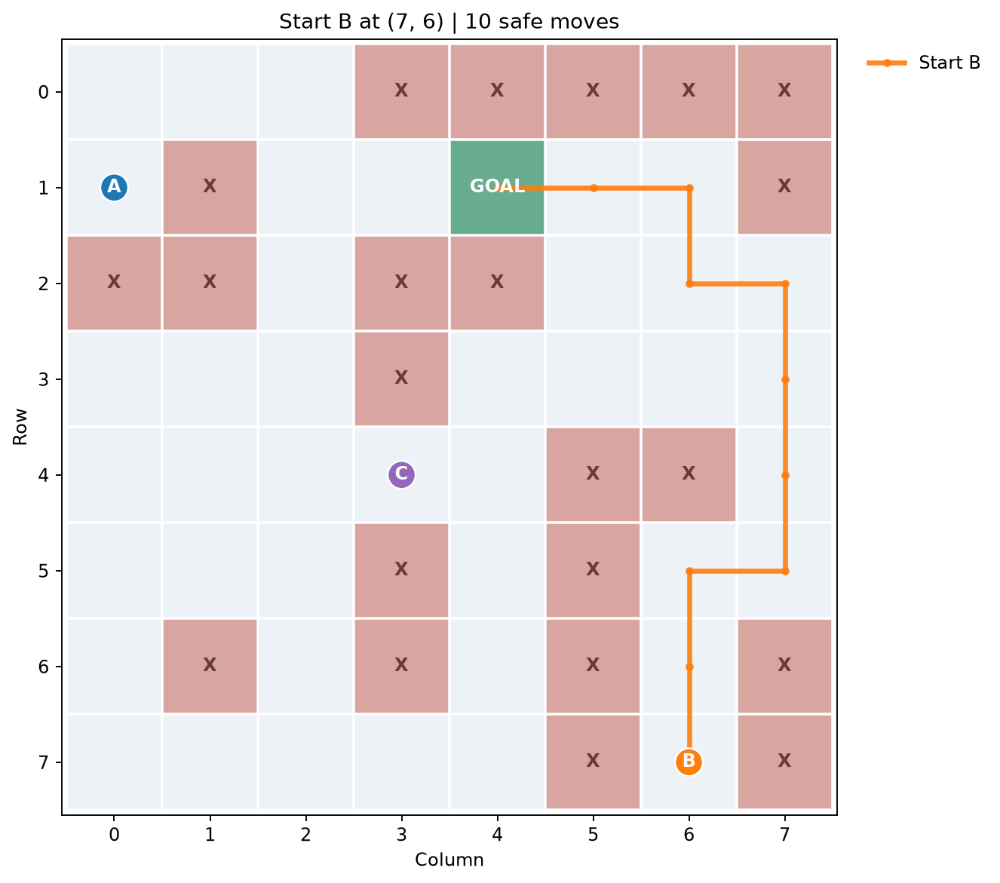
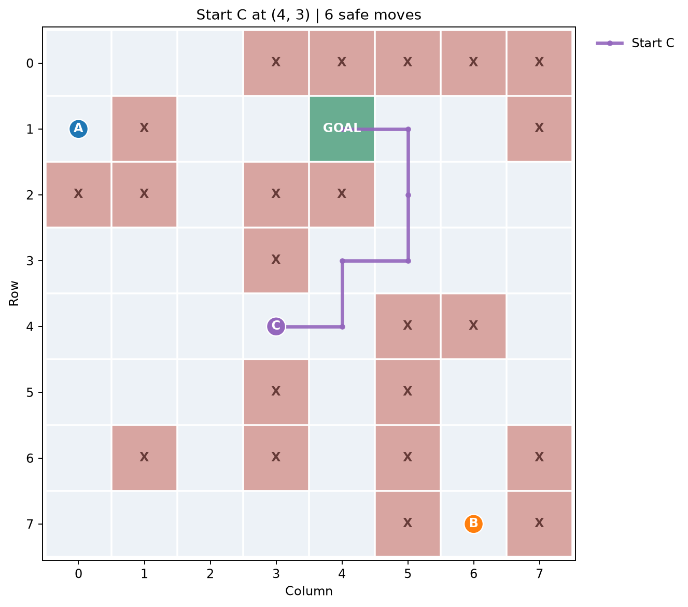
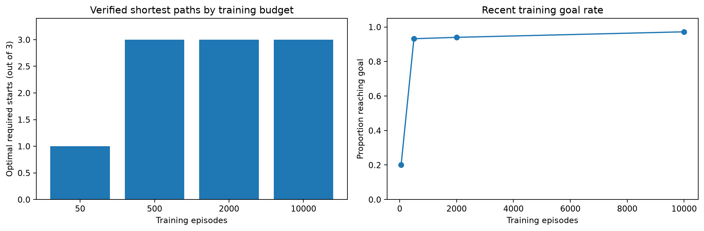
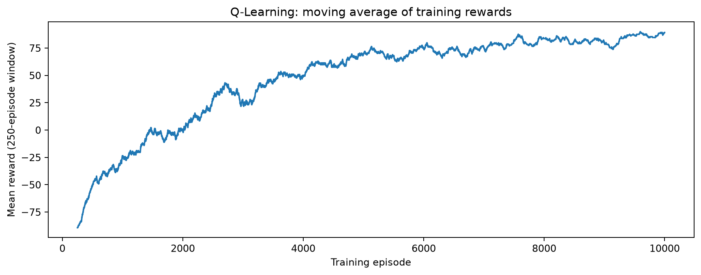
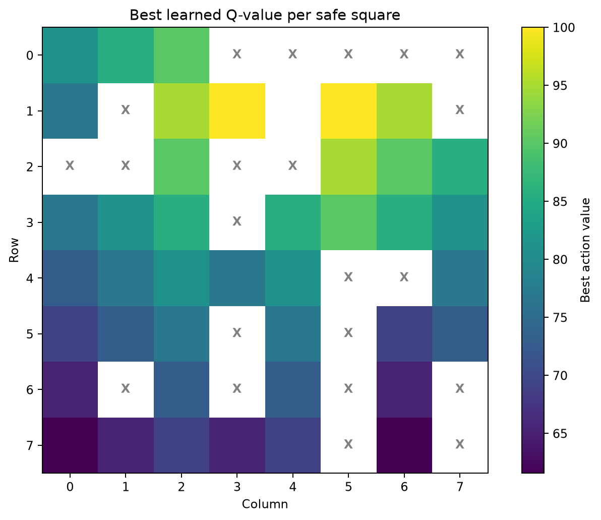

<div align="center">

# Assignment 9 | Q-Learning Cliff Navigation

### CAI2100C-2267-6908 | Machine Learning Foundations

**Juan Luna Santibanez**  
**Miami Dade College | Professor Beth Muturi**


**One 8 × 8 map. Three required starts. Three verified shortest safe paths.**

[**Academic Notebook**](academic/CAI2100C_Assignment_9_Q_Learning_Juan_Luna_Santibanez.ipynb) · [**Open in Google Colab**](https://colab.research.google.com/github/SupaHumano/CAI2100C-Assignment9-Q-Learning/blob/main/academic/CAI2100C_Assignment_9_Q_Learning_Juan_Luna_Santibanez.ipynb) · [**Colab Instructions**](docs/COLAB_GUIDE.md) · [**Interactive Demo**](index.html) · [**Professor's Requirements**](docs/ASSIGNMENT_REQUIREMENTS.md) · [**Q&A Guide**](docs/PRESENTATION_QA.md)

</div>



---

## My research problem

I am a Machine Learning researcher working through the autonomous-vehicle scenario described by Professor Muturi. I must train an agent to reach a Goal while avoiding Cliffs. I use **the actual 8 × 8 assignment map**, not the 5 × 6 reference example. I demonstrate one route from **(1, 0), (7, 6), and (4, 3)**, and compare how training episodes and learning rate affect the observed results.

My project is a **deterministic classroom demonstration**, not a real-world navigation system. I distinguish an optimal learned route from a drawn path generated by a search algorithm.

## The official map



I verified the map cell by cell against slide 5 of *Assignment 9*. It contains **64 total squares, 22 Cliffs, 41 walkable squares and one Goal at (1, 4)**. Coordinates are `(row, column)`, indexed from zero.

## What I learned: Q-Learning

I initialize an 8 × 8 × 4 Q-table. My four actions are up, right, down and left. During training, I reward reaching the Goal (+100), penalize entering a Cliff (-100) and charge -1 for each ordinary movement. I update action values based on these experiences.

My final configuration is **10,000 episodes, alpha = 0.30, gamma = 0.96, seed = 2026**, with an exploration probability that decreases from 0.60 toward 0.03. I allow exploratory Cliff failures during training but require the final greedy routes to be safe.

## Verified results

| Official starting location | Learned route | Independently verified shortest distance | Result |
|:---:|:---:|:---:|---|
| **(1, 0)** | **6 moves** | 6 moves | Optimal, no Cliff |
| **(7, 6)** | **10 moves** | 10 moves | Optimal, no Cliff |
| **(4, 3)** | **6 moves** | 6 moves | Optimal, no Cliff |

I verify the route lengths using **BFS after training**. BFS does not supply routes to the Q-Learning model. The notebook checks adjacent movements, terminal location, Cliff avoidance and minimum path length.

### My three route visualizations

| Start A: (1, 0) | Start B: (7, 6) | Start C: (4, 3) |
|:---:|:---:|:---:|
|  |  |  |

## My episode experiment

I compare **50, 500, 2,000, and 10,000 training episodes** using the same parameters and random seed. I retain 50, 500 and 2,000 from the course reference exercises and include 10,000 for my final study.



| Episodes | Required starts with optimal safe paths | Recent training Goal rate |
|---:|---:|---:|
| 50 | 1/3 | 20.0% |
| 500 | 3/3 | 93.2% |
| 2,000 | 3/3 | 94.0% |
| 10,000 | 3/3 | 97.2% |

With just 50 episodes, the model fails some required routes. In my seeded 500-, 2,000- and 10,000-episode tests, it learns all three shortest paths. A single seed does not establish that every configuration or future run will succeed.

### How I studied the model's learning

| Smoothed reward trajectory | Learned Q-values |
|:---:|:---:|
|  |  |

I also repeat the 2,000-episode experiment with `alpha = 0.10`, `0.30`, and `0.70`. I document each outcome in my notebook and exported results.

## Run my academic notebook

1. I download [**the single assignment notebook**](academic/CAI2100C_Assignment_9_Q_Learning_Juan_Luna_Santibanez.ipynb).
2. I open [Google Colab](https://colab.research.google.com/), choose **File > Upload notebook**, and upload the file.
3. I select **Runtime > Run all**, check the charts and read the final validation message.

I use only NumPy, Matplotlib and the Python standard library. **No Gym, API, external dataset, cloud credentials or repository-specific import is required.** This avoids Colab issues caused by unavailable dependencies and lets my professor execute the notebook directly.

**My submission file is the single `.ipynb` under `academic/`.** The website, figures, test script, and presentation materials are optional teaching and portfolio additions.

## My interactive visual portfolio

I published a static HTML dashboard where a visitor can switch among starts A, B, and C, inspect the path, and compare the learned route against independently verified BFS distances. The page **shows notebook-generated results, rather than training a new model in the browser**.

[**Open my interactive 8-by-8 Live Demo**](https://supahumano.github.io/CAI2100C-Assignment9-Q-Learning/) · [**Examine the three verified paths**](assets/three_routes.png)

My static educational demo uses the published website address https://supahumano.github.io/CAI2100C-Assignment9-Q-Learning/ when GitHub Pages is enabled. Its charts and routes come from my executed notebook; the browser does not retrain the model.

## My project's structure

```text
CAI2100C-Assignment9-Q-Learning/
├── README.md
├── index.html                         Interactive educational map
├── academic/
│   └── CAI2100C_Assignment_9_Q_Learning_Juan_Luna_Santibanez.ipynb
├── assets/
│   ├── official_assignment_map.png
│   ├── route_A.png / route_B.png / route_C.png
│   ├── three_routes.png
│   ├── episode_comparison.png
│   ├── learning_curve.png
│   └── q_value_heatmap.png
├── data/
│   ├── results.json
│   └── results.js
├── docs/
│   ├── ASSIGNMENT_REQUIREMENTS.md
│   ├── METHODOLOGY.md
│   ├── PRESENTATION_QA.md
│   ├── COLAB_GUIDE.md
│   └── AUDIT_REPORT.md
├── tests/
│   └── verify_assignment.py
├── presentation/
│   └── Assignment_9_Presentation_Juan_Luna_Santibanez.pptx
└── requirements.txt
```

## My verification standard

I check that the Python notebook runs without errors, the exact official map is preserved, all three required routes reach the Goal safely, the results equal independent BFS distances, and the web data match the exported notebook values. The [audit report](docs/AUDIT_REPORT.md) documents the results and the limitations.

## References

- Muturi, B. (2026). *Assignment 9* [Course PowerPoint, slides 2-6]. Miami Dade College, CAI2100C.
- Muturi, B. (2026). *Assignment 9 (Q-Learning)* [Course Jupyter notebook]. Miami Dade College.
- Watkins, C. J. C. H., & Dayan, P. (1992). Q-Learning. *Machine Learning, 8*, 279-292. https://doi.org/10.1007/BF00992698
- Farama Foundation. (n.d.). *Cliff Walking*. https://gymnasium.farama.org/v1.3.0/environments/toy_text/cliff_walking/ (reference only, not the assigned grid).

---

**Juan Luna Santibanez | Miami Dade College | Machine Learning Foundations | Professor Beth Muturi**